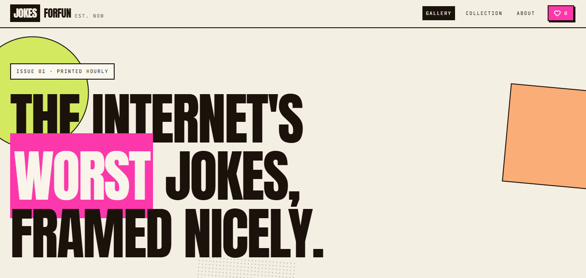
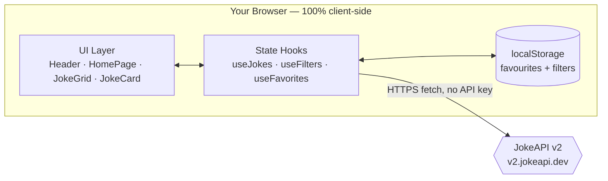
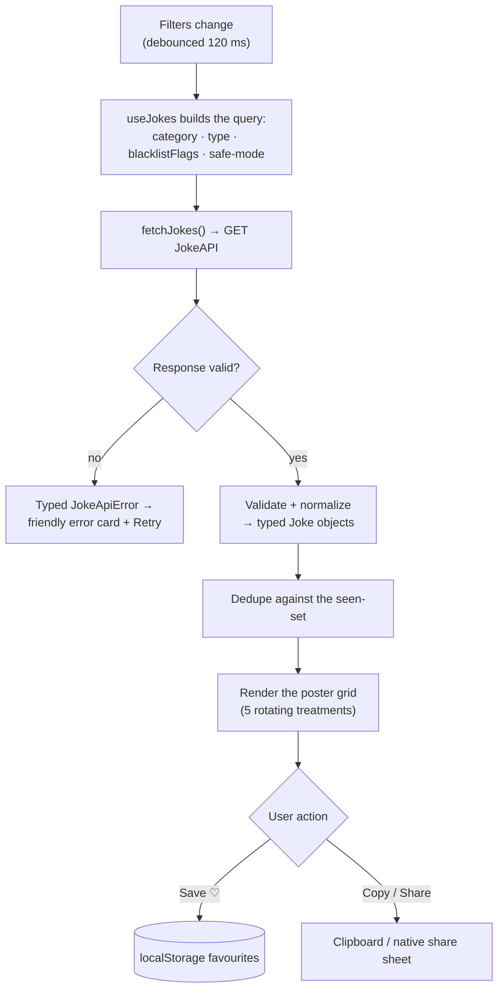
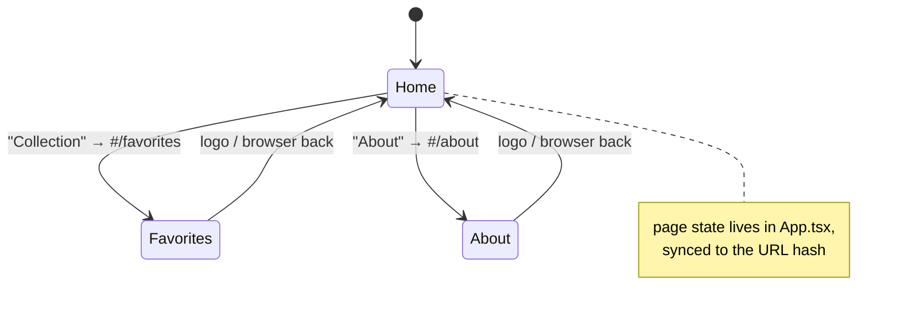

# JokesForFun — a poster gallery of terrible jokes

<p>
  <a href="https://phenomenal28.github.io/jokes-for-fun/"><strong>Live demo</strong></a> ·
  <a href="#how-it-works"><strong>How it works</strong></a> ·
  <a href="#getting-started"><strong>Getting started</strong></a> ·
  <a href="../../issues"><strong>Issues</strong></a>
</p>

[](https://github.com/Phenomenal28/jokes-for-fun/actions/workflows/deploy.yml)
[](./LICENSE)
[](https://react.dev)
[](https://www.typescriptlang.org)
[](https://vite.dev)

JokesForFun pulls jokes live from the free public [JokeAPI](https://jokeapi.dev) and prints them as risograph-style posters: heavy display type, paper grain, slightly-off rotations. Keep the good ones in a private in-browser collection; share the worst. No account, no backend — everything you save stays in your browser.



## What & why

**What:** a single-page app where every visit is a fresh gallery of jokes you can filter, favourite, and share.

**Why:** it started as a design question — *what if internet jokes looked like risograph prints?* — and became a deliberate exercise in keeping a modern front-end small: no router, no state-management library, no backend. The only network call is to JokeAPI; the only persistence is your own browser.

### Features

- Live jokes from JokeAPI v2 — no API key needed
- Filter by category, format, and content flags (exclude NSFW, political, religious, …), plus a strict safe mode
- Five rotating poster treatments so a gallery of six jokes never feels uniform
- Favourite jokes into a private, in-browser collection (`localStorage`)
- Copy any joke, or share it via the native share sheet on mobile
- "Surprise me" rolls a random category for you
- Motion respects `prefers-reduced-motion`, for anyone who asked their OS for less animation
- Skeleton loading states and friendly, typed error states with retry

## How it works

JokesForFun is 100% client-side. Three focused hooks own the state, a tiny context replaces the router, and a strict API client normalizes everything JokeAPI returns before the UI ever sees it.

### System architecture



### From filter change to poster



### Navigation without a router

Three pages don't justify a router dependency. `App.tsx` owns a single `page` state and keeps it in sync with the URL hash, so refresh and the browser back button still behave the way users expect.



## Tech stack

| Layer | Choice |
|---|---|
| UI | React 19 + TypeScript |
| Build | Vite 8 |
| Styling | Tailwind CSS v4 (official Vite plugin) |
| Components | base-ui primitives (button, bottom sheet) |
| Animation | anime.js v4 (card entrances, confirm pops) |
| Toasts | sonner |
| Data | JokeAPI v2 (public, keyless) |

## Project structure

```
src/
  App.tsx                App shell — owns the current page, syncs the URL hash
  main.tsx               React entry — loads CSS, renders <App/>
  index.css              The riso design system (colours, fonts, utilities)

  components/
    layout/              Header, Footer
    pages/               HomePage, FavoritesPage, AboutPage
    jokes/               JokeCard, JokeGrid, JokeActions, JokeSkeleton
    filters/             FilterPanel (the bottom sheet)
    favorites/           FavoritesView
    decorative/          FloatingShapes, GrainOverlay
    toast/               Toaster (the global toast listener)
    ui/                  button, sheet (the base-ui primitives)

  hooks/                 useJokes, useFilters, useFavorites, usePrefersReducedMotion
  lib/
    api/jokeApi.ts       JokeAPI client — query builder, validation, normalization
    navigation.tsx       The tiny context "router"
    animations/          anime.js card animations
    utils.ts             cn() class-merge helper
  types/
    joke.ts              Joke, JokeFilters, categories, flags
```

## Getting started

**Prerequisites:** Node.js 20.19+ or 22+, and npm.

```bash
# 1. Clone
git clone https://github.com/Phenomenal28/jokes-for-fun.git
cd jokes-for-fun

# 2. Install dependencies
npm install

# 3. Start the dev server
npm run dev
```

Then open the URL Vite prints — `http://localhost:5173/jokes-for-fun/`. (The base path exists so the production build works on GitHub Pages.)

### Scripts

| Command | What it does |
|---|---|
| `npm run dev` | Dev server with hot reload |
| `npm run build` | Type-check (`tsc --noEmit`) then production build to `dist/` |
| `npm run lint` | ESLint across the project |
| `npm run preview` | Serve the production build locally |

## Engineering decisions

- **No router.** Three pages don't justify the dependency. `App.tsx` owns one `page` state, synced to the URL hash (`#/favorites`), with `popstate` handling so back/forward work like a real router.
- **No state-management library.** Three hooks with clear ownership: `useJokes` (API state), `useFilters` (draft/applied filters, mirrored to `localStorage`), `useFavorites` (toggle/remove/clear over `localStorage`).
- **Never trust the network.** Raw JokeAPI responses are validated and normalized into typed `Joke` objects in `src/lib/api/jokeApi.ts`; failures surface as typed errors (`network` / `http` / `api` / `shape` / `empty`) the UI can respond to.
- **Requests are cancellable.** Every fetch runs under an `AbortController`; filter changes abort the in-flight request and are debounced 120 ms.
- **Persistence stays private.** Favourites and filters live only in your browser's `localStorage`. Clearing site data clears them.

## Notes

- Jokes come from [JokeAPI](https://jokeapi.dev) — content can't be controlled, which is exactly what the filter panel is for.
- Fonts (Anton, Space Grotesk, JetBrains Mono) load from Google Fonts in `index.html`.
- Deployed to GitHub Pages by [this workflow](.github/workflows/deploy.yml) on every push to `main`.

## License

[MIT](./LICENSE) © 2026 Phenomenal28
